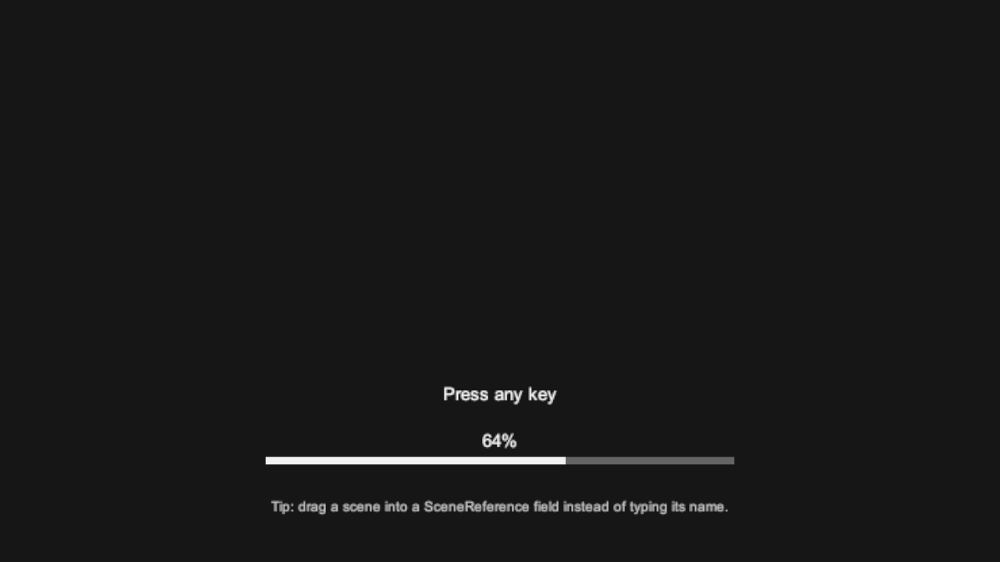

# Scene Loader

**Scene loading for Unity 6**: fade transitions, a loading screen with progress, scenes you drag into
the Inspector instead of typing names, scene groups, objects that survive scene changes, and a scene
switcher window. One line of code, or no code at all.

[English](#english) · [Türkçe](#türkçe)



---

<a name="english"></a>
# English

- `SceneLoader.Load("Level1")`: a short black fade, the scene changes behind it, done.
- **Loading screen** with a progress bar, percentage and tips, a **minimum time** so it doesn't flash,
  and an optional **"Press any key"** step.
- **Scene references**: drag a scene asset into a field. It keeps working when you rename or move the
  scene, and shows an **Add to Build** button if the scene can't be loaded.
- **No-code components**: a button that loads a scene, a trigger zone (level exit, door), load on start
  (boot scene), and **Persistent Object** (music player, managers: exactly one, across all scenes).
- **Scene groups**: load several scenes together (Level + Lighting + UI).
- **Window > Atthree > Scenes**: open, play and order the build scenes; **Play From First Scene** so
  Play mode always starts in your boot scene.
- Fades in real time (works when the game is paused), fades the **sound** with the picture, resets
  `Time.timeScale` after loading from a pause menu, blocks clicks while covered.

**Requirements:** Unity 6 (6000.0+). uGUI (installed by default). The Input System package is optional
("press any key" works with either input system).

## Step-by-step

### 1. Add the package

**Window > Package Manager** → **+** → **Install package from git URL…** →

```
https://github.com/Atthree/SceneLoader.git
```

To lock a version: `https://github.com/Atthree/SceneLoader.git#v0.1.0`

### 2. Put your scenes in the build list

Only scenes in the build list can be loaded. **Window > Atthree > Scenes** → **Add** next to each scene
(or **Add Open Scenes**). The first one is the scene the game starts with.

### 3. Your own menu buttons (no code)

1. Select one of your UI **Buttons** (e.g. "Play") → **Add Component** → **Scene Load Button**.
2. **Action**: *Load Scene*. Drag your level scene into **Scene**.
3. Play and click. That's it: the button's own OnClick list doesn't need anything.

Use the same component on all your own buttons, only the **Action** changes:

| Button | Action |
|---|---|
| Play | `Load Scene` → your first level |
| Quit | `Quit` |
| Try Again (game over / pause menu) | `Reload` |
| Next Level | `Load Next` (the next scene in the build list) |
| Main Menu | `Load Scene` → your menu scene |

Tick **Custom Options** to change this button's load: **Fade Color**, **Fade Out / In Duration**,
**Loading Screen** ✓, **Min Loading Time**, **Wait For Input**.

> Nothing happens on click? The scene needs an **EventSystem** (GameObject > UI > Event System).

### 4. A level exit (no code)

1. Create a cube where the exit is → on its collider tick **Is Trigger** → remove the Mesh Renderer if
   you want it invisible.
2. **Add Component** → **Scene Load Trigger** → choose the next scene.
3. Give your player the **Player** tag. The player needs a Rigidbody or CharacterController.

### 5. From code

```csharp
using Atthree.SceneLoading;
using UnityEngine;

public class GameFlow : MonoBehaviour
{
    public SceneReference mainMenu;   // drag the scene here
    public SceneReference level1;

    public void Play()     => SceneLoader.Load(level1, LoadOptions.WithLoadingScreen(minTime: 1.5f));
    public void Restart()  => SceneLoader.Reload();
    public void ToMenu()   => SceneLoader.Load(mainMenu, LoadOptions.Fade(0.6f, Color.white));
    public void Quit()     => SceneLoader.Quit();
}
```

Your own UI scripts work the same way. A pause menu:

```csharp
using Atthree.SceneLoading;
using UnityEngine;

public class PauseMenu : MonoBehaviour
{
    public SceneReference mainMenu;   // drag the menu scene here

    // connect these to your buttons' OnClick lists
    public void Restart() => SceneLoader.Reload();
    public void ToMenu()  => SceneLoader.Load(mainMenu);
    public void Quit()    => SceneLoader.Quit();
}
```

Paused with `Time.timeScale = 0`? Fine: fades use real time, and the new scene starts at time scale 1.

More:

```csharp
// wait for it in a coroutine
yield return SceneLoader.Load("Boss");

// or get told when it's done
SceneLoader.Load(level).Completed += op => Debug.Log($"{op.SceneName} loaded");

// a good moment to save: the screen is covered, the old scene is still there
SceneLoader.BeforeSceneUnload += op => SaveGame();

// change the default for every load (e.g. in your boot scene)
SceneLoader.DefaultOptions = LoadOptions.Fade(0.5f, new Color(0.1f, 0f, 0.15f));

// add/remove a scene without a transition (UI scene, level chunk)
SceneLoader.LoadAdditive(hudScene);
SceneLoader.Unload(hudScene);
```

### 6. A boot scene

Many games start in an empty **Boot** scene that creates the managers (audio, save, input) and then
opens the menu:

1. Make a scene **Boot**, put it first in the build list.
2. Add your managers with **Add Component > Persistent Object** on each.
3. Add an empty object with **Load Scene On Start** → *Load Scene* → your menu.
4. In **Window > Atthree > Scenes**, turn on **Play From First Scene**. Now pressing Play in any scene
   starts from Boot, just like the real game.

### 7. Your own loading screen (your own design)

1. **GameObject > UI > Canvas**. Put your design in it: a background image, a logo, texts.
2. For the progress bar add an **Image**, give it a sprite, set **Image Type** = `Filled`,
   **Fill Method** = `Horizontal`. (A **Slider** works too.)
3. Select the Canvas → **Add Component** → **Loading Screen**. Drag the bar into **Progress Bar**
   (or **Progress Slider**), and optionally a text into **Progress Text** ("64%") and **Tip Text**.
   Write your tips into **Tips**, one is picked at random.
   - **TextMeshPro**: use the events instead. **On Progress Text** → your TMP text → `text`.
     **On Progress** (0–1) for anything else, e.g. an animation.
   - **Continue Prompt**: an object (e.g. a "Press any key" text) that is shown when
     **Wait For Input** is on and the scene is ready. Add **Blinking Text** to it for a pulse.
4. Drag the Canvas into the Project window to make a **prefab**, then delete it from the scene.
5. On your button/trigger: **Custom Options** ✓ → **Loading Screen** ✓ → drag the prefab into
   **Loading Screen Prefab**. From code:

```csharp
public LoadingScreen myLoadingScreen;   // the prefab

void Play()
{
    var options = LoadOptions.WithLoadingScreen(minTime: 2f);
    options.loadingScreenPrefab = myLoadingScreen;
    SceneLoader.Load(level1, options);
}
```

Want it everywhere? Set it once at startup: `SceneLoader.DefaultOptions = options;`

Custom transitions work the same way: derive from `SceneTransition`, implement `Cover` and `Reveal`, put
it on a prefab, set **Transition = Custom**. Or put **Fade Transition** on a Canvas with a CanvasGroup
and a logo to fade a branded screen.

### 8. Try the demo

**Package Manager** → **Scene Loader** → **Samples** → **Demo** → **Import**. Then
**Window > Atthree > Scenes** → **Add** next to *Demo Menu*, *Demo Level 1*, *Demo Level 2* (in that
order) → open *Demo Menu* → **Play**.

## Where to use it

| Game | Use |
|---|---|
| Any game with a menu | Scene Load Buttons for Play / Quit, a fade between menu and game |
| Level-based (platformer, puzzle) | Scene Load Trigger at the exit with **Load Next**; **Reload** for restart |
| Big scenes (open world, many assets) | Loading screen with tips and a minimum time; `BeforeSceneUnload` to save |
| Story games | **Wait For Input** so the player reads the tip; custom colors per chapter |
| Larger projects | Boot scene + Persistent Objects + Play From First Scene; scene groups for split levels |

## Good to know

- **One load at a time.** A second `Load` during a load is ignored with a warning (no double-clicks
  loading twice). Check `SceneLoader.IsLoading` if you need to.
- The transition and loading screen are kept with `DontDestroyOnLoad` while loading and destroyed
  afterwards. A `[Scene Loader]` object stays to run the loads.
- **Times are real seconds** (`unscaledDeltaTime`), so fades work at `Time.timeScale = 0`.
- **Audio fade** uses `AudioListener.volume` and puts it back to what it was.
- `LoadNext` at the last scene goes to the first one (pass `wrap: false` to stop instead).
- **Wait For Input** only works with a loading screen (it shows the "Press any key" prompt). From a UI
  button you can call `SceneLoader.Continue()`.
- A `SceneReference` finds its scene by path, then by name, so it still works if the scene was moved
  and the field wasn't shown in the Inspector since.

## Troubleshooting

| Problem | Fix |
|---|---|
| "isn't in the build list" | **Window > Atthree > Scenes** → **Add**, or the **Add to Build** button next to the scene field. |
| The trigger doesn't fire | The collider must be **Is Trigger**, the player needs the **Player** tag and a Rigidbody/CharacterController. |
| The button does nothing | Is there an **EventSystem** in the scene? (GameObject > UI > Event System) |
| Clicking during a load does nothing | That's on purpose: only one load at a time. |
| The game is silent after loading | Something else changed `AudioListener.volume` during the load. Turn off **Fade Audio** if you control it yourself. |
| Play From First Scene doesn't start in Boot | The first *enabled* scene in the build list is used. Check its order in the Scenes window. |

## How it works

- `LoadSceneAsync` with `allowSceneActivation = false` on the last scene: the scene loads in the
  background up to 90 %, waits for the minimum time and the key press, then is switched on behind the
  cover.
- Order: cover (+ audio out) → loading screen appears → `BeforeSceneUnload` → load → cover again →
  activate → `SceneActivated` → reveal (+ audio in) → `LoadCompleted`.
- The loading screen progress never goes backwards and, with a minimum time, fills up evenly instead of
  jumping.

## Tests

26 PlayMode tests: loading by name and path, event order, ignoring a second load, missing scenes, fade
covering the switch and being removed, fade duration, instant loads, audio fade, time scale, loading
screen progress and minimum time, wait for input, reload, load next with wrapping, groups, additive
load/unload, scene references, persistent objects, the button, the trigger, load on start, default
options. They make their own test scenes and remove them afterwards.

To run them, add to `Packages/manifest.json`:

```json
"testables": [ "com.atthree.scene-loader" ]
```

then **Window > General > Test Runner > PlayMode > Run All**.

## License

[MIT](LICENSE.md)

---

<a name="türkçe"></a>
# Türkçe

- `SceneLoader.Load("Level1")`: kısa bir siyah geçiş, arkasında sahne değişir, bitti.
- İlerleme çubuğu, yüzde ve ipuçlarıyla **yükleme ekranı**. Yanıp sönmesin diye **en az süre**, istersen
  **"Bir tuşa bas"** adımı.
- **Sahne referansları**: sahneyi alana sürükle. Sahneyi yeniden adlandırsan ya da taşısan da çalışır.
  Sahne yüklenemiyorsa yanında **Add to Build** butonu çıkar.
- **Kodsuz bileşenler**: sahne yükleyen buton, tetikleyici alan (bölüm çıkışı, kapı), açılışta yükle
  (boot sahnesi) ve **Persistent Object** (müzik çalar, yöneticiler: tüm sahnelerde tam bir tane).
- **Sahne grupları**: birkaç sahneyi birlikte yükle (Bölüm + Işık + UI).
- **Window > Atthree > Scenes**: build sahnelerini aç, oynat, sırala. **Play From First Scene** ile Play
  her zaman boot sahnesinden başlar.
- Geçişler gerçek zamanla çalışır (oyun duraklatılmışken de). **Sesi** de görüntüyle birlikte kısar,
  duraklatma menüsünden yüklenince `Time.timeScale`'i 1 yapar, ekran kapalıyken tıklamaları engeller.

**Gereksinim:** Unity 6 (6000.0+). uGUI (varsayılan olarak kurulu). Input System paketi isteğe bağlı
("bir tuşa bas" iki giriş sistemiyle de çalışır).

## Adım adım

### 1. Paketi ekle

**Window > Package Manager** → **+** → **Install package from git URL…** →

```
https://github.com/Atthree/SceneLoader.git
```

Sürüm sabitlemek için: `https://github.com/Atthree/SceneLoader.git#v0.1.0`

### 2. Sahnelerini build listesine koy

Sadece build listesindeki sahneler yüklenebilir. **Window > Atthree > Scenes** → her sahnenin yanındaki
**Add** (ya da **Add Open Scenes**). İlk sıradaki, oyunun açıldığı sahnedir.

### 3. Kendi menü butonların (kodsuz)

1. Kendi UI **Button**'larından birini seç (örn. "Oyna") → **Add Component** → **Scene Load Button**.
2. **Action**: *Load Scene*. Bölüm sahneni **Scene** alanına sürükle.
3. Play'e bas ve tıkla. Bu kadar: butonun kendi OnClick listesine bir şey eklemene gerek yok.

Kendi butonlarının hepsinde aynı bileşeni kullan, sadece **Action** değişir:

| Buton | Action |
|---|---|
| Oyna | `Load Scene` → ilk bölümün |
| Çıkış | `Quit` |
| Tekrar Dene (ölünce / duraklatma menüsü) | `Reload` |
| Sonraki Bölüm | `Load Next` (build listesindeki sıradaki sahne) |
| Ana Menü | `Load Scene` → menü sahnen |

O butonun yüklemesini değiştirmek için **Custom Options**'ı işaretle: **Fade Color** (geçiş rengi),
**Fade Out / In Duration** (kararma/açılma süresi), **Loading Screen** ✓ (yükleme ekranı),
**Min Loading Time** (en az kaç saniye görünsün), **Wait For Input** (tuşa basılmasını bekle).

> Tıklayınca bir şey olmuyor mu? Sahnede **EventSystem** olmalı (GameObject > UI > Event System).

### 4. Bölüm çıkışı (kodsuz)

1. Çıkışın olduğu yere bir küp koy → collider'ında **Is Trigger**'ı işaretle → görünmesin istersen Mesh
   Renderer'ı kaldır.
2. **Add Component** → **Scene Load Trigger** → sonraki sahneyi seç.
3. Oyuncuna **Player** tag'ini ver. Oyuncuda Rigidbody ya da CharacterController olmalı.

### 5. Koddan

Kendi UI scriptlerin de aynı şekilde çalışır. Örnek bir duraklatma menüsü:

```csharp
using Atthree.SceneLoading;
using UnityEngine;

public class PauseMenu : MonoBehaviour
{
    public SceneReference mainMenu;   // menü sahnesini buraya sürükle

    // bunları butonlarının OnClick listesine bağla
    public void Restart() => SceneLoader.Reload();
    public void ToMenu()  => SceneLoader.Load(mainMenu);
    public void Quit()    => SceneLoader.Quit();
}
```

Oyunu `Time.timeScale = 0` ile durdurduysan sorun yok: geçişler gerçek zamanla çalışır, yeni sahne
normal hızda başlar. Daha fazla örnek (coroutine'de bekleme, `BeforeSceneUnload` ile kaydetme,
varsayılan ayarı değiştirme) İngilizce bölümde.

### 6. Boot sahnesi

Çoğu oyun boş bir **Boot** sahnesinde açılır: yöneticileri (ses, kayıt, giriş) oluşturur, sonra menüyü açar.

1. **Boot** adında bir sahne yap, build listesinde en başa koy.
2. Yöneticilerine **Add Component > Persistent Object** ekle.
3. Boş bir objeye **Load Scene On Start** ekle → *Load Scene* → menü sahnen.
4. **Window > Atthree > Scenes**'te **Play From First Scene**'i aç. Artık hangi sahnede Play'e basarsan
   bas, gerçek oyundaki gibi Boot'tan başlar.

### 7. Kendi tasarımınla yükleme ekranı

1. **GameObject > UI > Canvas**. İçine kendi tasarımını koy: arka plan görseli, logo, yazılar.
2. İlerleme çubuğu için bir **Image** ekle, sprite ver, **Image Type** = `Filled`,
   **Fill Method** = `Horizontal` yap. (**Slider** da olur.)
3. Canvas'ı seç → **Add Component** → **Loading Screen**. Çubuğu **Progress Bar**'a (ya da
   **Progress Slider**'a) sürükle. İstersen bir yazıyı **Progress Text**'e ("%64") ve **Tip Text**'e koy.
   İpuçlarını **Tips**'e yaz, rastgele biri gösterilir.
   - **TextMeshPro** kullanıyorsan olayları kullan: **On Progress Text** → TMP yazın → `text`.
     **On Progress** (0–1) başka şeyler için, örneğin bir animasyon.
   - **Continue Prompt**: **Wait For Input** açıkken sahne hazır olunca görünen obje (örneğin "Bir tuşa
     bas" yazısı). Yanıp sönsün istersen ona **Blinking Text** ekle.
4. Canvas'ı Project penceresine sürükleyip **prefab** yap, sonra sahneden sil.
5. Butonunda/tetikleyicinde: **Custom Options** ✓ → **Loading Screen** ✓ → prefab'ı
   **Loading Screen Prefab** alanına sürükle. Koddan kullanımı İngilizce bölümde. Her yüklemede
   kullanılsın istersen açılışta bir kez `SceneLoader.DefaultOptions = options;` yap.

Kendi geçişin için: `SceneTransition`'dan türet, `Cover` ve `Reveal`'ı yaz, prefab'a koy,
**Transition = Custom** seç. Ya da logolu bir Canvas'a CanvasGroup ve **Fade Transition** ekle.

### 8. Demoyu dene

**Package Manager** → **Scene Loader** → **Samples** → **Demo** → **Import**. Sonra
**Window > Atthree > Scenes** → *Demo Menu*, *Demo Level 1*, *Demo Level 2* yanındaki **Add** (bu sırayla)
→ *Demo Menu*'yü aç → **Play**.

## Nerede kullanılır

| Oyun | Kullanım |
|---|---|
| Menüsü olan her oyun | Play / Quit için Scene Load Button, menü ile oyun arasında geçiş |
| Bölümlü oyunlar (platform, bulmaca) | Çıkışta **Load Next**'li Scene Load Trigger, yeniden başlatmak için **Reload** |
| Büyük sahneler (açık dünya, çok asset) | İpuçlu ve en az süreli yükleme ekranı, kaydetmek için `BeforeSceneUnload` |
| Hikâye oyunları | Oyuncu ipucunu okusun diye **Wait For Input**, bölüm başına farklı renk |
| Büyük projeler | Boot sahnesi + Persistent Object + Play From First Scene, bölünmüş bölümler için sahne grupları |

## Bilmekte fayda var

- **Aynı anda tek yükleme.** Yükleme sürerken gelen ikinci `Load` uyarıyla yok sayılır (çift tıklama iki
  kez yüklemez). Gerekirse `SceneLoader.IsLoading`'e bak.
- Geçiş ve yükleme ekranı yükleme boyunca `DontDestroyOnLoad` ile korunur, sonra silinir. Yüklemeleri
  çalıştırmak için bir `[Scene Loader]` objesi kalır.
- **Süreler gerçek saniye** (`unscaledDeltaTime`), yani `Time.timeScale = 0` iken de çalışır.
- **Ses geçişi** `AudioListener.volume` kullanır ve eski değerine geri getirir.
- Son sahnede `LoadNext` ilk sahneye döner (durmasını istersen `wrap: false`).
- **Wait For Input** sadece yükleme ekranıyla çalışır ("Press any key" yazısını o gösterir). UI butonundan
  `SceneLoader.Continue()` çağırabilirsin.

## Sorun giderme

| Sorun | Çözüm |
|---|---|
| "isn't in the build list" | **Window > Atthree > Scenes** → **Add**, ya da sahne alanının yanındaki **Add to Build**. |
| Tetikleyici çalışmıyor | Collider **Is Trigger** olmalı, oyuncuda **Player** tag'i ve Rigidbody/CharacterController olmalı. |
| Buton bir şey yapmıyor | Sahnede **EventSystem** var mı? (GameObject > UI > Event System) |
| Yükleme sırasında tıklama çalışmıyor | Bilerek böyle: aynı anda tek yükleme. |
| Yüklemeden sonra ses yok | Yükleme sırasında başka bir şey `AudioListener.volume`'u değiştirmiş. Sesi kendin yönetiyorsan **Fade Audio**'yu kapat. |
| Play From First Scene Boot'tan başlamıyor | Build listesindeki ilk *işaretli* sahne kullanılır. Scenes penceresinden sırasına bak. |

## Testler

26 PlayMode testi. Kendi test sahnelerini oluşturur, sonra siler. Çalıştırmak için
`Packages/manifest.json` içine `"testables": [ "com.atthree.scene-loader" ]` ekle, sonra
**Window > General > Test Runner > PlayMode > Run All**.

## Lisans

[MIT](LICENSE.md)
